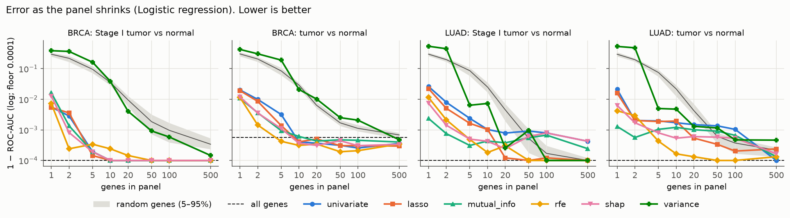

# How much of the transcriptome do you need to detect cancer?

**Short answer: in TCGA tissue, almost none of it.** One or two well-chosen genes reach the
same ROC-AUC as all ~17,700 expressed genes, for breast and lung adenocarcinoma, and for
Stage I tumors as well as all stages. That result has a less flattering reading, though:
tumor vs adjacent normal tissue is an easy problem. Several hundred genes each separate the
classes almost perfectly. The useful scientific content therefore lies in how the selected
genes compare with random genes, and in which genes get selected.

Every number below comes from `results/tables/`. The setup: 5×5 repeated, patient-grouped
cross-validation, with gene selection repeated inside each training fold, so test samples
never influence which genes are chosen.

## The brief, point by point
| Asked for | What was done | Result |
|---|---|---|
| 1–2 cancer types with public expression data | TCGA BRCA (1,211 samples) and LUAD (573) via UCSC Xena; tumor vs normal, plus Stage I tumors vs normal | §1 |
| Start with hundreds/thousands of genes | 20,530 genes in source; 17,699–17,955 after a label-free filter | §1 |
| LASSO, mutual information, RFE, SHAP | All four, plus univariate, top-variance and random baselines | §3 |
| Panels of 500 → 100 → 50 → 20 → 10 | Done, extended to 5, 2, 1 | §2 |
| Logistic regression, RF, XGBoost, simple neural net | All four; within 0.008 AUC at 10 genes | §2 |
| Does the smallest panel retain performance? | Yes: 1–2 genes non-inferior to all genes for every model and task | §2 |
| Known biological relevance? | Yes (literature, pathways, known stroma/tissue markers), but mostly lost normal-tissue genes and not cancer drivers | §5 |
| How much information can be removed? | Over 99.99% of genes in this setting | §6 |

Interactive version of this report: `docs/report.html` (built by `scripts/build_report_page.py`).

## Data
| | samples | tumor | normal | patients | genes after filter |
|---|---|---|---|---|---|
| BRCA, tumor vs normal | 1,211 | 1,097 | 114 | 1,097 | 17,699 |
| BRCA, Stage I vs normal | 296 | 182 | 114 | 276 | 17,755 |
| LUAD, tumor vs normal | 573 | 514 | 59 | 515 | 17,944 |
| LUAD, Stage I vs normal | 333 | 274 | 59 | 304 | 17,955 |

"Normal" means solid tissue next to the tumor, usually from the same patient. Patients are
the CV grouping unit, so a patient's tumor and normal samples always fall in the same fold.

## 1. The ceiling: the task is easier than it looks
Before any modelling, **459 BRCA genes and 779 LUAD genes each reach in-sample AUC ≥ 0.95
by themselves** (notebook 01). Every model on all genes scores ROC-AUC ≥ 0.997 and
sensitivity ≥ 0.98 at 95% specificity. Stage I tumors are no harder to detect than tumors
overall. In this data, transcriptome-level detection does not get harder for earlier tumors.

## 2. How far can the panel shrink?
Smallest panel that is **non-inferior to all genes**, meaning the lower 95% bound of the
paired fold-wise ΔAUC (panel − all genes) stays above −0.01 (`retention.csv`):

| | LogReg | RF | XGBoost | MLP |
|---|---|---|---|---|
| BRCA tumor vs normal (best selector) | 2 | 2 | 2 | 2 |
| BRCA Stage I vs normal | 1 | 2 | 2 | 2 |
| LUAD tumor vs normal | 1 | 2 | 2 | 1 |
| LUAD Stage I vs normal | 1 | 2 | 2 | 1 |
| **Top-variance genes (label-free)** | 5–50 | 5–20 | 5–50 | 5–500 |

Logistic regression AUC (mean over 25 folds), selected vs random panels:

| genes | BRCA best selected | BRCA random | LUAD best selected | LUAD random |
|---|---|---|---|---|
| 1 | 0.989 | 0.696 | 0.999 | 0.704 |
| 2 | 0.999 | 0.793 | 0.999 | 0.803 |
| 5 | 1.000 | 0.915 | 1.000 | 0.925 |
| 10 | 1.000 | 0.971 | 1.000 | 0.978 |
| 50 | 1.000 | 0.998 | 1.000 | 0.999 |
| all (~17.7k) | 0.999 | | 1.000 | |

(BRCA and LUAD rows show the tumor-vs-normal task; Stage I results are almost identical,
see `summary.csv`.)

- **Selection matters only at small panel sizes.** At k ≤ 5, every supervised selector beat
  all 20 random panels in every cancer and task (logistic regression, the model used for
  the random baseline; empirical p = 1/21, the minimum possible with 20 draws). By k = 50, random genes are within 0.002 AUC of the best panel.
  The disease signal is spread so widely across the transcriptome that any 50 genes
  capture it.
- **Removing ~99.99% of genes costs nothing measurable.** At the screening-relevant
  operating point (95% specificity), the best 2-gene logistic regression panel detects
  99.4–99.9% of tumors across the four tasks, and the best 5-gene panel 99.6–100%. The
  weakest selector's 2-gene panel still detects 94%.
- **Fewer genes can do better.** For BRCA tumor vs normal, panels of 10–500 selected genes
  have lower error (1 − AUC ≈ 2–5×10⁻⁴) than the all-genes model (≈ 6×10⁻⁴); see
  `figures/error_vs_k_logreg.png`. With 1,000 training samples and 17,700 features, the
  noise genes cost more than they contribute.
- **The model barely matters.** At k = 10, all four classifiers fall within 0.008 AUC
  of each other for every selector. At k = 1, logistic regression and the MLP slightly beat the tree models
  (`figures/heatmap_k1.png`), because trees can only threshold a single gene in steps.
  XGBoost is by far the slowest on all genes (about 19 s per fit vs 1.5–3 s for the
  others) and gains nothing for the extra cost.
- **Unsupervised selection fails.** The single most variable gene gives AUC 0.46–0.68,
  *worse than a random gene* (≈ 0.70). In LUAD the top-variance gene is **RPS4Y1** (selected in 84–92% of
  folds), with **XIST** next: both encode patient sex, not cancer. This is a clear example
  of why "important genes" must be defined with respect to the label.

## 3. Which method picks the best genes?
No method wins everywhere. In LUAD at k = 1, mutual information, RFE and SHAP find
clearly better single genes than univariate ranking or LASSO (AUC 0.989–0.999 vs
0.974–0.984). In BRCA, all methods fall within 0.011 of each other, and for Stage I the
univariate test and LASSO come out slightly ahead. Above k = 5, the selectors are
indistinguishable.

**Stability** (mean pairwise Jaccard of fold panels, `stability.csv`) is moderate. At
k = 10, the overlap between any two folds' panels ranges from 35% to 80% depending on
method and cancer. Univariate ranking is the most stable, RFE and SHAP the least. With hundreds of near-equivalent
genes available, *which* small panel gets chosen depends on the training sample, but
*how well* it performs does not. That warns against reading too much into any single
"signature".

## 4. Cross-cancer transfer
The 10-gene consensus panel from one cancer, applied to the other (`transfer.csv`):

| panel from → evaluated on | retrained on target (CV AUC) | model applied unchanged (AUC / sens@95spec) |
|---|---|---|
| BRCA → LUAD | 0.998 | 0.997 / 0.98 |
| LUAD → BRCA | 0.995 | 0.964 / 0.76 |

The BRCA genes detect lung cancer almost as well as LUAD's own panel, and BRCA's trained
model works on lung tissue without retraining. Much of the signal is therefore
**not tissue-specific**: tumors lose the normal tissue's stroma, fat, and vasculature
programs, and that loss looks similar across organs.

## 5. Are the genes biologically meaningful?
**Consensus 10-gene panels** (genes ranked by how often the five supervised selectors pick
them across folds; log2 fold change, tumor − normal):

- **BRCA:** MMP11 +5.8, COL10A1 +6.8, NEK2 +4.6; down: CA4, FIGF (VEGF-D), CD300LG, MYOC,
  CPA1, SPRY2. Stage I panel adds ADAMTS5, SDPR (CAVIN2), MME, LMOD1.
- **LUAD:** PYCR1 +3.7; down: ANGPT4, EMP2, STX11, RTKN2, TNNC1, SH3GL3, CD5L, C13orf36,
  C10orf67. Stage I panel adds CAV1, OTUD1, WWC2.

Interpretation:
- **Most selected genes are lost, not gained, in tumors** (16 of 20 in the two all-stage
  panels). They mark normal-tissue identity: adipose and endothelium in breast (CA4,
  CD300LG, FIGF), alveolar and vascular tissue in lung (EMP2, ANGPT4, CAV1). The genes
  that go up are the classic **tumor-stroma remodelling** genes in breast (COL10A1, MMP11),
  proliferation (NEK2), and proline metabolism in lung (PYCR1). Univariate top-100 BRCA
  genes are enriched for *G2-M checkpoint* and *extracellular structure organization*
  (Enrichr FDR ≤ 0.001; `enrichment.csv`).
- **Literature support beats chance.** Selected genes have median 10 (BRCA) and 2–2.5
  (LUAD) PubMed abstracts co-mentioning the cancer type, vs 0–1 for random genes
  (one-sided Mann-Whitney p = 0.0008–0.013; `pubmed_summary.csv`). MMP11 (102 abstracts), NEK2 (74),
  CA4 (55), CAV1 (49), and COL10A1 (34) are well studied in these cancers.
- **They are not cancer driver genes.** The panels are *not* enriched for OncoKB cancer
  genes at any size (hypergeometric p > 0.05 everywhere; `oncokb_overlap.csv`). A
  detection panel and a driver list answer different questions: drivers are often
  mutated without changing expression, while detection relies on large, consistent
  expression shifts in the tissue.

## 6. Answer to the research question
> *How much biological information can we remove while preserving cancer-detection performance?*

**In TCGA tissue: over 99.99% of the genes, down to one or two, with no measurable loss.**
The same holds for Stage I tumors. But this is not evidence that cancer is "simple".
Detection signal is so redundant in tissue that the full transcriptome mostly adds noise,
and many different small panels work equally well (low stability, good cross-cancer
transfer). What small panels capture best is the **replacement of normal tissue
architecture** (stroma, fat, vasculature, alveoli), not a cancer-intrinsic program.

## Limitations and what would make this stronger
1. **Tissue is not screening.** Early detection in practice works on blood (cfRNA,
   cfDNA methylation) or other minimally invasive samples, where tumor signal is diluted
   1,000-fold or more. These AUCs say nothing about that setting. Testing the panels on a
   liquid-biopsy expression dataset is the obvious next step.
2. **Adjacent normal ≠ healthy.** TCGA normals come from cancer patients. Adding healthy
   tissue from GTEx (watch for batch effects) would test whether the panels separate
   cancer from truly healthy tissue.
3. **One platform, one consortium.** All samples share TCGA processing. An independent GEO
   cohort, or a different assay (qPCR, microarray), would test whether 1–2-gene panels
   survive batch effects. They usually degrade more than larger panels.
4. **The ceiling limits resolution.** With AUC ≈ 0.999 everywhere, differences between
   methods sit at the 10⁻³ level. A harder task (tumor subtype, stage II vs I, metastasis
   risk) would separate the selection methods more clearly.
5. CIs treat the 25 repeated-CV folds as independent, which they are not, so the
   intervals are somewhat too narrow. The non-inferiority calls are robust to this,
   because the margins at k ≥ 2 are much smaller than the 0.01 threshold.

## Reproduce
See [README.md](README.md). `genepanel all` regenerates every table and figure from scratch
(the CV run took 20 minutes on 8 cores; downloads are about 100 MB).
